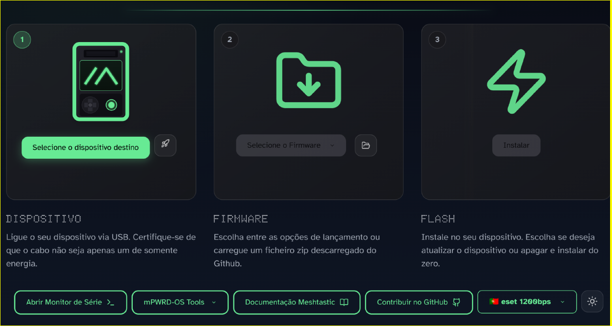

# Rádio LoRa (Meshtastic)

O Seeed XIAO corre o software **Meshtastic**, funcionando como transmissor transparente de texto.

***

### Passo 1: Instalação do Firmware

1. Enrosca ou encaixa a antena de 868 MHz no módulo.
2. Liga o XIAO ao computador via cabo USB-C.
3. Acede ao [**Meshtastic Web Flasher**](https://flasher.meshtastic.org/) através do Google Chrome ou Edge.
4. Escolhe o teu modelo de placa e instala a última versão estável (**Stable**).

***

### Passo 2: Configuração dos Parâmetros

Acede ao gestor web em [**client.meshtastic.org**](https://client.meshtastic.org/) e clica em **New Connection ➜ Serial**.

Altera os menus com os seguintes valores (clicando em **Save** em cada um):

#### 1. Rádio (Radio Config ➜ LoRa)

* **Region:** `European Union 868MHz`
* **Preset:** `SHORT_FAST`
* **Hop Limit:** `3`
* **Ignore MQTT:** `ON`
* **OK to MQTT:** `ON`

#### 2. Canais (Channels ➜ Canal Primário)

* **Channel Name:** `VROOOM`
* **PSK (Chave de Encriptação):** `RA==` (8 bits padrão)
* **Uplink:** `Ativado`
* **Downlink:** `Ativado`

#### 3. Comunicação Série (Module Config ➜ Serial)

* **Serial Enabled:** `ON`
* **Serial Mode:** `TEXTMSG`
* **Baud Rate:** `BAUD_38400`
* **Timeout:** `2`



- **RX Pin:** `44`
- **TX Pin:** `43`



* **RX Pin:** `7`
* **TX Pin:** `6`


