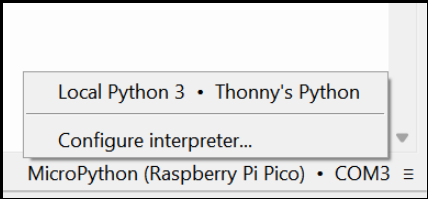

# Raspberry Pi Pico (MicroPython)

O Raspberry Pi Pico corre um script em MicroPython encarregue de:

1. Ler os registos contínuos da porta VE.Direct do Victron.
2. Armazenar um histórico num ficheiro de texto local.
3. Formatar as variáveis e enviá-las pela segunda UART para o rádio LoRa.

***

### 1. Instalação do Firmware MicroPython

1. Mantém premido o botão **BOOTSEL** no Pico enquanto o ligas ao computador por USB.
2. Abre a drive que surge no computador (`RPI-RP2`).
3. Descarrega o ficheiro UF2 oficial em [micropython.org](https://micropython.org/download/rp2-pico/) e arrasta-o para a drive.

***

### 2. Gravação do Programa (`main.py`)

1. Abre o [**Thonny IDE**](https://thonny.org/).
2. No canto inferior direito, seleciona o interpretador: **MicroPython (Raspberry Pi Pico)**.
3. Descarrega o código fonte:
   * [pico.py (Repositório Oficial)](https://github.com/n1ghtbyte/pico_meshtastic_testing/blob/main/rpi_pico_examples/send_uart/pico.py)
4. No menu superior do Thonny: **Ficheiro ➜ Guardar Como... ➜ Raspberry Pi Pico**.
5. Guarda o ficheiro com o nome exato **`main.py`** (desta forma, o script arranca automaticamente ao ligar a alimentação do carro). 

<figure><figcaption></figcaption></figure>

***

### 3. Como Aceder aos Logs da Corrida

Os dados da corrida ficam gravados no ficheiro **`dados_corrida_testing.txt`** dentro da memória do Pico.

1. Liga o Pico ao computador e abre o Thonny.
2. Clica no botão vermelho **STOP** para parar o código.
3. No painel de ficheiros do Thonny (no canto inferior esquerdo), clica duas vezes no ficheiro `dados_corrida_testing.txt` ou clica com o botão direito para transferir para o teu PC.
4. Embora termine em `.txt`, a formatação interna é **CSV** (campos separados por vírgulas), podendo ser aberto diretamente no Microsoft Excel ou Google Sheets.
