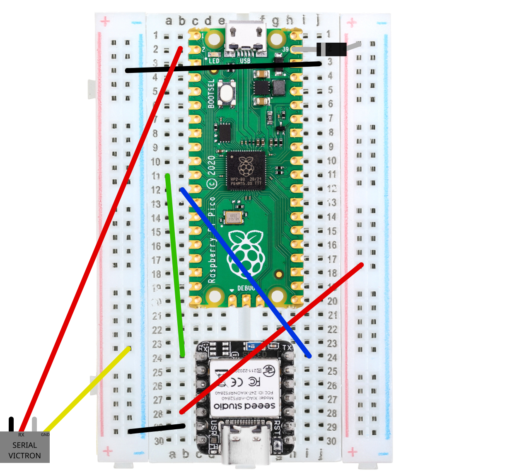

# Esquema Elétrico e Ligações

Esta página explica como interligar todos os componentes na breadboard de forma segura, com especial atenção à convenção de pinos, à polaridade dos componentes e à proteção elétrica contra retorno de corrente.



---

## 1. Circuito de Alimentação (LM2596 & Díodo de Proteção)

O circuito é alimentado a partir da bateria principal do carro solar (normalmente entre 12V e 24V DC).

```
[Bateria do Carro (12V - 24V)]
               │
               ▼
   [Conversor LM2596 Step-Down]
               │
               ├─► Regulado rigorosamente para 5.0V DC
               │
               ├──► Barramento Positivo da Breadboard (5V)
               │      ├─► Pino 5V do Seeed XIAO
               │      └─► [Ânodo] Díodo Schottky [Cátodo com risca] ──► Pin 39 (VSYS) do Pico
               │
               └──► Barramento Negativo da Breadboard (GND comum)
```

### Passo Prévio Obrigatório: Afinar o Regulador

**Risco de queima por sobretensão:**  
O conversor LM2596 standard suporta até 30V–35V na entrada. **Antes de ligares qualquer componente à breadboard**, liga o LM2596 à bateria do carro e, com as pontas de um multímetro na saída, roda o parafuso do potenciómetro até obteres rigorosamente **5.0V DC**.


### Como e Porquê Ligar o Díodo de Proteção:
* O díodo (idealmente um **Schottky 1N5817** ou um comum 1N4001) cria uma barreira unidirecional entre a fonte do carro e o microcontrolador.
* **Polaridade do Díodo:**
  * **Ânodo (lado preto sem risca):** Liga à linha de 5.0V da breadboard.
  * **Cátodo (lado com a risca prateada/branca):** Liga ao **Pin 39 (VSYS)** do Raspberry Pi Pico.
* **Porquê esta proteção?**  
  Se precisares de ligar o cabo USB do computador ao Pico na grelha de partida (para ajustar código no Thonny) com o carro ligado, o díodo impede que a corrente do computador e a do regulador LM2596 colidam, evitando queimar as portas USB ou o microcontrolador.

---

## 2. Diagramas de Pinout Oficiais

Para consultar visualmente onde fica cada pino antes de encaixar os fios:

### Pinout Oficial do Raspberry Pi Pico
No Raspberry Pi Pico, identifica os pinos de comunicação **GP8 (Pin 11)**, **GP9 (Pin 12)**, o pino de leitura do Victron **GP1 (Pin 2)**, a alimentação **VSYS (Pin 39)** e a massa **GND (Pin 18 ou 38)**:


---

### Pinout Oficial do Seeed Studio XIAO

Seleciona abaixo a versão da placa XIAO que a tua equipa está a utilizar para veres o mapa de pinos correspondente:





* **Etiqueta D7 (RX de série):** Corresponde ao **GPIO 44** no software Meshtastic.
* **Etiqueta D6 (TX de série):** Corresponde ao **GPIO 43** no software Meshtastic.
* **Pinos 5V e GND:** Situados no topo esquerdo da placa.






* **Etiqueta D7 (RX de série):** Corresponde ao **GPIO 7** (P0.07 / P1.12) no software Meshtastic.
* **Etiqueta D6 (TX de série):** Corresponde ao **GPIO 6** (P0.06 / P1.11) no software Meshtastic.
* **Pinos 5V e GND:** Situados no topo esquerdo da placa.




---

## 3. Convenção de Cores para os Fios Jumper

Para evitar confusões visuais na montagem, padroniza as cores dos fios na bancada da equipa:

* ⬛ **Fio Preto:** Linha de Massa comum (GND).
* 🟥 **Fio Vermelho:** Linha de Alimentação positiva (5V / VSYS).
* 🟨 **Fio Amarelo:** Envio de dados do Pico para o rádio XIAO (TX ➜ RX).
* 🟩 **Fio Verde:** Retorno de dados do rádio XIAO para o Pico (RX ⮌ TX).

---

## 4. Tabela de Interligação "De ➜ Para"


Todos os pinos identificados como **GND** no Raspberry Pi Pico (Pin 3, 8, 13, 18, 23, 28 e 38) estão ligados internamente na mesma placa de circuito impresso. Podes usar qualquer um deles.


| Fio Recomendado | No RASPBERRY PI PICO<br>*(Microcontrolador Principal)* | No SEEED STUDIO XIAO<br>*(Texto impresso na placa)* | O que faz este fio? (Função Elétrica) |
| :---: | :--- | :--- | :--- |
| ⬛ **Preto** | **Pin 18 (GND)** *(ou Pin 38)* | **Pino GND** | Cria a referência de 0V (massa comum) entre as duas placas. |
| 🟨 **Amarelo** | **Pin 11** *(Pino de função GP8 / UART1 TX)* | **Pino D7** | **Envio:** O Pico envia os dados formatados para o rádio LoRa. |
| 🟩 **Verde** | **Pin 12** *(Pino de função GP9 / UART1 RX)* | **Pino D6** | **Receção:** O Pico escuta respostas ou comandos do rádio. |
| 🟥 **Vermelho** | **Pin 39 (VSYS)**<br>*(Ligado após o cátodo do díodo)* | **Pino 5V** *(ou VBUS)* | Distribui a energia estável de 5.0V a ambos os módulos. |

---

## 5. Mapeamento de Pinos para a Configuração do Meshtastic

Ao parametrizares o módulo de rádio no **Meshtastic** (no separador *Module Config ➜ Serial*), deves introduzir o número GPIO correspondente à versão da placa XIAO que a tua equipa está a usar:




* **RX Pin no software:** Introduz **`44`** *(este pino corresponde fisicamente à etiqueta D7 na placa)*.
* **TX Pin no software:** Introduz **`43`** *(este pino corresponde fisicamente à etiqueta D6 na placa)*.





* **RX Pin no software:** Introduz **`7`** *(este pino corresponde fisicamente à etiqueta D7 na placa)*.
* **TX Pin no software:** Introduz **`6`** *(este pino corresponde fisicamente à etiqueta D6 na placa)*.




---

## 6. Ligação do Cabo ao Victron MPPT (Resumo)

O cabo JST-PH de telemetria vindo do regulador solar liga-se diretamente ao Pico em pinos dedicados:

* **Pino 1 do Victron (GND):** Liga ao **Pin 38 (GND)** do Raspberry Pi Pico.
* **Pino 3 do Victron (TX):** Liga ao **Pin 2 (GP1 / UART0 RX)** do Raspberry Pi Pico.
* *(Os pinos 2 e 4 do Victron devem ficar isolados e desligados).*

Para instruções completas sobre o desbaste da ficha JST e remoção do jumper de fábrica, consulta a página dedicada: **[Ligação ao MPPT Victron](victron-mppt.md)**.

---

## 7. Checklist de Segurança Antes de Ligar a Energia

Antes de ligares o interruptor do carro solar, confirma os seguintes 4 pontos críticos:

- [ ] **Antena LoRa:** A antena de 868 MHz está enroscada no conector do XIAO? *(Ligar sem antena queima o transmissor).*
- [ ] **Tensão do LM2596:** Foi confirmada com multímetro a saída em exatamente 5.0V?
- [ ] **Polaridade do Díodo:** A risca prateada/branca do díodo está virada para o Pin 39 (VSYS) do Pico?
- [ ] **Jumper do Victron:** O jumper de plástico preto de fábrica foi retirado da porta VE.Direct?
