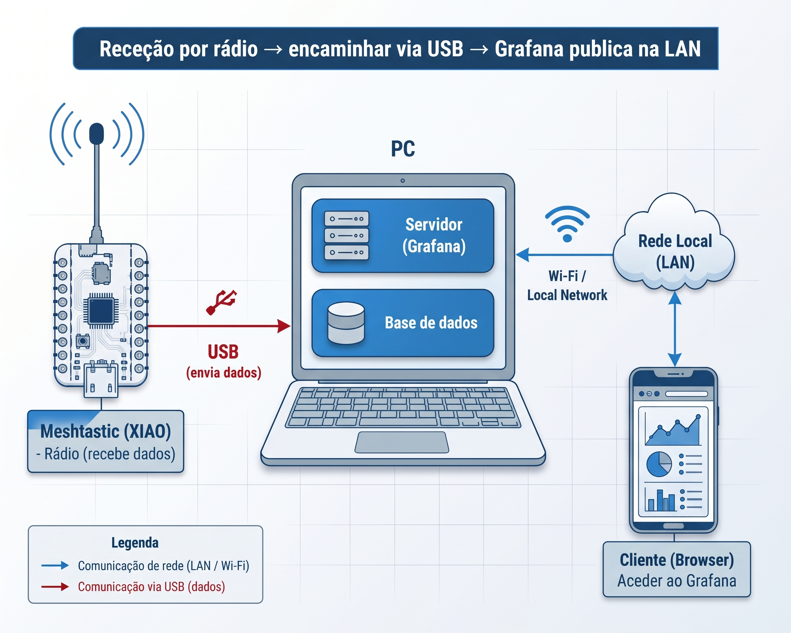

# Estação Base & Grafana

Na bancada técnica das boxes, não é necessário utilizar um Raspberry Pi Pico. A estação base é composta apenas por um computador portátil e um **segundo módulo Seeed Studio XIAO** (com antena de 868 MHz) ligado diretamente por cabo USB.

Este computador escuta as mensagens LoRa que chegam pelo ar, guarda-as continuamente num ficheiro CSV e disponibiliza um servidor **Grafana** para acompanhamento gráfico em tempo real.

***

## 1. Arquitetura da Estação Base

```
[Carros em Pista] ──(Emissão LoRa 868 MHz)──► [Antena do XIAO Recetor]
                                                        │
                                                        │ (Cabo USB-C)
                                                        ▼
                                              [Computador das Boxes]
                                                        │
                                                        ├─► 1. Script Python (read_mesh_2_csv.py)
                                                        │      (Lê a porta série e cria telemetria.csv)
                                                        │
                                                        └─► 2. Contentor Docker (Grafana)
                                                               (Lê o ficheiro CSV e gera os gráficos)
                                                                │
                                                                ▼
                                                Navegador Web: http://localhost:3000
```

***

## 2. Preparação do Ambiente Python (com `uv`)

Para garantir que o script corre sem conflitos em qualquer sistema operativo, utilizamos o [**`uv`**](https://github.com/astral-sh/uv), um gestor de pacotes Python ultra-rápido e moderno.



Abre a **PowerShell** como utilizador normal e executa os seguintes comandos:

```powershell
# 1. Instalar o gestor uv
powershell -c "irm https://astral.sh/uv/install.ps1 | iex"

# 2. Fechar e reabrir a PowerShell para atualizar o PATH, depois clonar o repositório
git clone https://github.com/n1ghtbyte/pico_meshtastic_testing.git
cd pico_meshtastic_testing/rpi_pico_examples/read_uart

# 3. Criar o ambiente virtual isolado
uv venv

# 4. Ativar o ambiente virtual
.venv\Scripts\activate

# 5. Instalar as bibliotecas necessárias
uv pip install meshtastic pypubsub

# 6. Iniciar o leitor do rádio
python read_mesh_2_csv.py
```



Abre o **Terminal** e executa os seguintes comandos:

```bash
# 1. Instalar o gestor uv
curl -LsSf https://astral.sh/uv/install.sh | sh

# 2. Recarregar o terminal e clonar o repositório
git clone https://github.com/n1ghtbyte/pico_meshtastic_testing.git
cd pico_meshtastic_testing/rpi_pico_examples/read_uart

# 3. Criar o ambiente virtual isolado
uv venv

# 4. Ativar o ambiente virtual
source .venv/bin/activate

# 5. Instalar as bibliotecas necessárias
uv pip install meshtastic pypubsub

# 6. Iniciar o leitor do rádio
python read_mesh_2_csv.py
```


**Permissões de Porta Série no Linux:**\
Se receberes um erro de acesso negado à porta `/dev/ttyACM0` ou `/dev/ttyUSB0`, adiciona o teu utilizador ao grupo dialout executando:\
`sudo usermod -a -G dialout $USER` (depois reinicia a sessão).




Assim que o script `read_mesh_2_csv.py` arranca, ele deteta automaticamente a porta USB do XIAO e começa a imprimir no terminal cada pacote de telemetria recebido do carro solar.

***

## 3. Lançamento do Painel no Grafana (Docker)

O painel visual e os dashboards pré-configurados correm dentro de um contentor **Docker**, eliminando a necessidade de instalar bases de dados complexas no computador da equipa.

### Pré-requisitos

* Ter o [**Docker Desktop**](https://www.docker.com/products/docker-desktop/) instalado e a correr no computador portátil.

### Passos de Execução:

1. Mantém a janela do terminal do script Python aberta.
2. Abre uma **segunda janela de terminal**.
3.  Navega até à pasta do Grafana dentro do repositório:

    ```bash
    cd pico_meshtastic_testing/grafana
    ```
4.  Inicia o contentor com o Docker Compose:

    ```bash
    docker compose up -d
    ```
5. Aguarda cerca de 30 a 60 segundos enquanto os serviços inicializam.

***

## 4. Como Aceder e Utilizar o Painel

1.  Abre o teu navegador de internet (Chrome, Firefox ou Edge) e acede a:

    ```
    http://localhost:3000
    ```
2. Na página de autenticação, insere as credenciais por omissão:
   * **Utilizador:** `admin`
   * **Palavra-passe:** `admin`
3. No menu lateral esquerdo, clica em **Dashboards ➜ Browse ➜ CSV Dashboards**.
4. Seleciona o painel de controlo correspondente ao vosso carro solar.


**Dica para os Gráficos:**\
Se o gráfico parecer vazio no início da corrida, clica no botão de **Auto-Zoom** ou no seletor de tempo no canto superior direito do Grafana e escolhe **"Last 5 minutes"** com atualização automática para **"5s"** (5 segundos).


***

## 5. Partilha de Ecrã nas Boxes (Acesso Multi-Dispositivo)

Não precisas que toda a equipa esteja aglomerada à volta do mesmo portátil. Uma vez iniciado o servidor Grafana, qualquer elemento da equipa pode consultar os gráficos no seu telemóvel, tablet ou outro computador:

1. Liga todos os dispositivos à mesma rede Wi-Fi (pode ser o Hotspot móvel de um telemóvel na box).
2. Descobre o endereço IP local do computador que tem o Docker a correr:
   * **Windows:** Abre a linha de comandos e escreve `ipconfig` (procura pelo _Endereço IPv4_, ex: `192.168.1.85`).
   * **Linux/macOS:** Abre o terminal e escreve `hostname -I` ou `ifconfig`.
3.  Nos telemóveis ou tablets da box, basta abrir o browser e colocar o endereço com a porta `:3000`:

    ```
    http://192.168.1.85:3000
    ```
4. O painel de telemetria fica visível com atualização em direto para toda a equipa de apoio.

***

## 6. Diagnóstico e Resolução de Problemas

### O script `read_mesh_2_csv.py` não deteta o XIAO na porta USB

* Confirma se o cabo USB-C suporta transmissão de dados (muitos cabos de telemóvel baratos são apenas para carregamento).
* Certifica-te de que o software **Thonny** ou o monitor de série do Arduino IDE estão fechados; duas aplicações não podem aceder à mesma porta USB em simultâneo.

### O Grafana mostra "Data source not found" ou tabelas vazias

* Verifica se o script Python já recebeu pelo menos um pacote rádio e se o ficheiro `.csv` de dados já foi gerado na pasta. O Grafana só consegue desenhar os gráficos após a criação das primeiras linhas do ficheiro.
